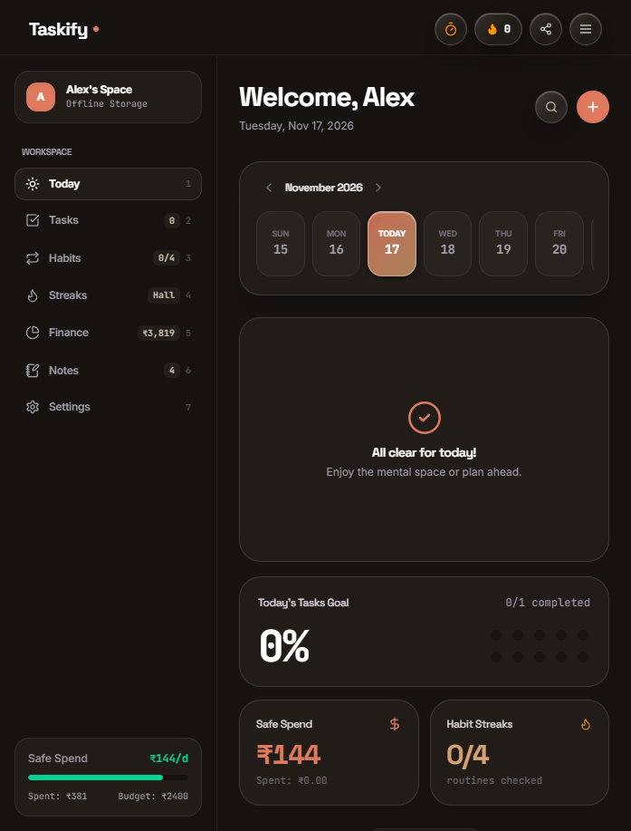
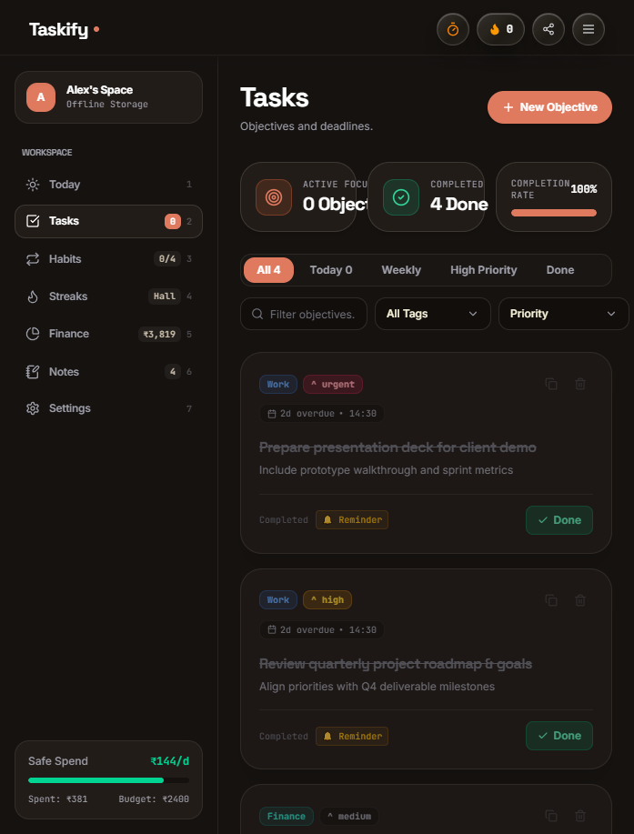
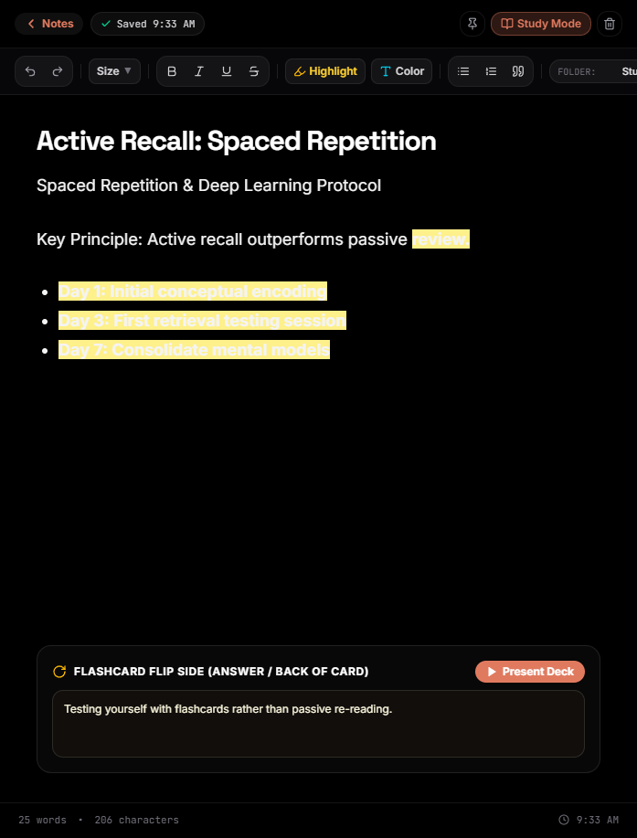
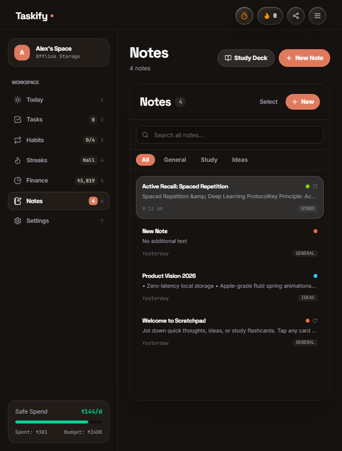
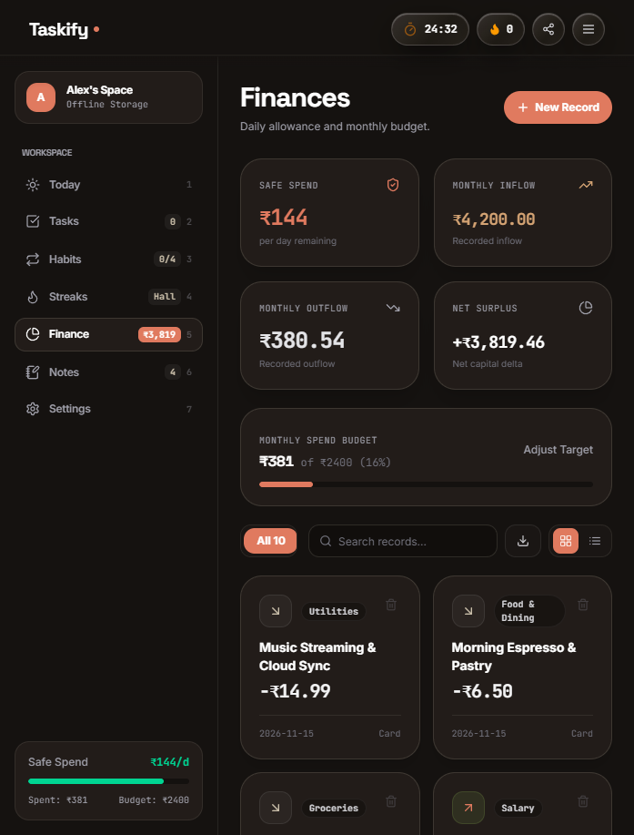
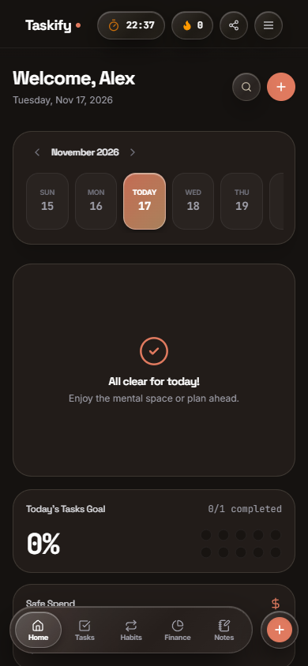
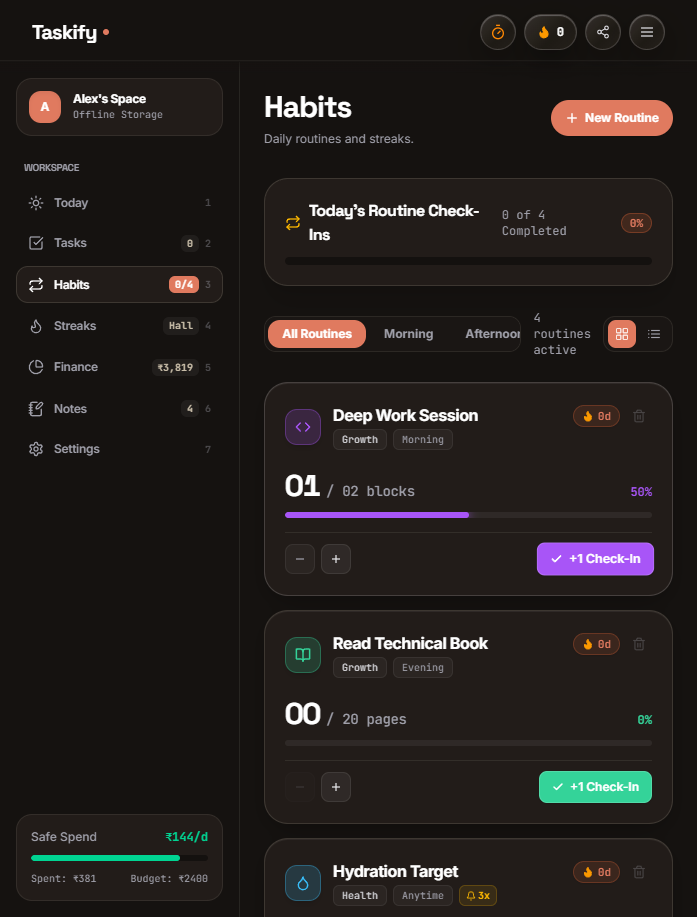

<div align="center">

# Taskify

### The local-first, privacy-native productivity operating system.

[](LICENSE)
[](https://react.dev)
[](https://www.typescriptlang.org)
[](https://tailwindcss.com)
[](https://dexie.org)
[](https://capacitorjs.com)
[](test/core-logic.test.mjs)
[](CONTRIBUTING.md)

<p align="center">
  <b>Zero mandatory accounts. Zero remote servers. Zero telemetry. 100% data sovereignty.</b><br>
  Engineered with tactile design foundations, fluid spring physics, and solid surface minimalism.
</p>

<p align="center">
  <a href="#downloads">Download App</a> •
  <a href="#core-features">Features</a> •
  <a href="#interface-showcase">Showcase</a> •
  <a href="#architecture">Architecture</a> •
  <a href="#quickstart">Quickstart</a> •
  <a href="#contributing">Contributing</a>
</p>

</div>

---

## Overview

Taskify is an open-source personal life operating system that unifies **Task Management**, **Atomic Habit Tracking**, **Deep Focus Cycles**, **Distraction-Free Notes**, and **Daily Cashflow Discipline** into a single sub-16ms, zero-latency desktop and mobile application.

Unlike modern productivity tools that lock personal data behind remote cloud servers, monthly subscriptions, and mandatory logins, Taskify is built on a **local-first architecture**. Every task, habit check-in, note, and transaction is stored directly in your browser or device using **IndexedDB (via Dexie.js)**. Your data never leaves your hardware.

---

## Downloads

Taskify is cross-platform and runs natively across desktop and mobile devices.

| Platform | Format | Release Link | Compatibility |
|:---|:---|:---|:---|
| **Windows** | `.exe` / Portable | [Download for Windows](https://github.com/your-username/taskify/releases/latest) | Windows 10 & 11 (64-bit) |
| **macOS** | `.dmg` (Universal) | [Download for macOS](https://github.com/your-username/taskify/releases/latest) | Apple Silicon (M1/M2/M3/M4) & Intel |
| **Android** | `.apk` | [Download Android APK](https://github.com/your-username/taskify/releases/latest) | Android 10 or newer |
| **iPhone / iPad** | Safari PWA / IPA | [Install on iOS](https://github.com/your-username/taskify/releases/latest) | iOS 16 or newer |
| **Web Browser** | Self-hosted PWA | [Run Web Version](http://localhost:5173) | Any modern evergreen browser |

---

## Interface Showcase

<div align="center">
  
</div>

<br>

<div align="center">
  
  &nbsp;
  
</div>

<br>

<div align="center">
  
  &nbsp;
  
</div>

<br>

<div align="center">
  
  &nbsp;
  
</div>

---

## Engineering Foundations

- **100% Data Sovereignty**: All relational tables live locally in IndexedDB. No company server, no tracking beacons, and no telemetry SDKs.
- **Sub-16ms Viscous Fluid Motion**: Horizontal tab transitions run on the flat hardware compositor with exponential momentum projection and deferred commit. Zero frame drops on flagship or budget devices.
- **Tactile Design Foundations**: Translucent materials (`backdrop-filter: blur(24px) saturate(190%)`), dynamic specular borders, optical typography tracking, and tactile spring feedback.
- **Offline Reliability**: Full functionality without an internet connection. No network request is required to open, edit, create, or search data.

---

## Core Features

### 1. Today Command Center
- Contextual daypart greetings and daily motivational nudges.
- Live streak flame counter tracking unbroken momentum.
- Real-time Safe Spend velocity indicator and pending task glance.

### 2. Bento Milestone Tasks
- Visual Bento Milestone cards with category capsules and priority pills (High, Medium, Low).
- Instant toggle to a Swiss Minimalist compact row layout for rapid triage.
- Due dates with ISO calendar picker, reminder chime sounds, and completion chimes.

### 3. Atomic Habits and Consistency Streaks
- Habit tracking with targets, times of day, and custom counters.
- 14-week consistency heatmap matrix and unlockable milestone badges.
- Streak Freeze Shields to safeguard momentum during travel or rest days.

### 4. Distraction-Free Aesthetic Notes
- Notepad with instant autosave on every keystroke.
- Rich formatting toolbar for bold, italic, highlights, code blocks, lists, and color accents.
- Word count, character count, search filter, and multi-select batch deletion.
- Fullscreen mobile notepad that covers the viewport for focused writing.

### 5. Pomodoro Focus Timer
- Tactile circular focus progress ring with live digital countdown.
- Preset focus lengths (5m, 15m, 25m, 45m, 60m, 90m) and custom duration drum dials.
- Integrated settings sheet for tick sounds, background ambience, and screen edge glow.

### 6. Cashflow and Daily Safe-to-Spend
- Automatic daily safe-to-spend calculation based on monthly budget and remaining calendar days.
- Income and expense capture with payment classification (Card, Mobile Wallet, Cash, Bank Transfer).
- Client-side zero-API currency symbol detection based on system timezone and locale.

### 7. 7 Handcrafted Solid Themes
- `Warm Espresso & Ochre` (Flagship warm earth minimal)
- `Nordic Frost & Platinum` (Glacier cyan & deep slate)
- `Kyoto Matcha & Bamboo` (Zen moss & bamboo green)
- `Amber Dune & Sahara Gold` (Molten liquid gold & dusk)
- `Forest Moss & Rose Noir` (Woodland green & dusty rose)
- `Tokyo Cyber Amethyst` (Midnight black & electric violet)
- `Obsidian Pure OLED` (Pitch black monochrome)

---

## Architecture

```
┌────────────────────────────────────────────────────────┐
│                   Taskify Client                       │
│        React 19 + TypeScript + Tailwind CSS v4         │
└───────────────────────────┬────────────────────────────┘
                            │
              ┌─────────────┴─────────────┐
              ▼                           ▼
   ┌────────────────────┐      ┌────────────────────┐
   │    Web Runtime     │      │  Capacitor Native  │
   │  Vite Production   │      │   iOS & Android    │
   └──────────┬─────────┘      └──────────┬─────────┘
              │                           │
              └─────────────┬─────────────┘
                            ▼
              ┌───────────────────────────┐
              │    Local Data Engine      │
              │   IndexedDB (Dexie.js)    │
              │   • Tasks & Milestones    │
              │   • Habits & Logs         │
              │   • Notes & Scratchpad    │
              │   • Transactions Ledger   │
              │   • Preferences Store     │
              └───────────────────────────┘
```

---

## Tech Stack

| Component | Technology | Version |
|:---|:---|:---|
| **UI Framework** | React | 19.0 |
| **Language** | TypeScript | 5.7 |
| **Bundler & Tooling** | Vite | 6.1 |
| **Utility CSS** | Tailwind CSS | 4.0 |
| **Physics & Motion** | Framer Motion | 12.4 |
| **Local Database** | Dexie.js (IndexedDB) | 4.0 |
| **Mobile Runtime** | Capacitor | 8.5 |
| **Icons** | Lucide React | 0.475 |

---

## Quickstart

### Prerequisites
- [Node.js](https://nodejs.org) version 20 or newer
- [npm](https://www.npmjs.com) version 10 or newer

### Installation

```bash
# Clone the repository
git clone https://github.com/your-username/taskify.git
cd taskify

# Install dependencies
npm install

# Start local development server
npm run dev
```

Open `http://localhost:5173` in your browser.

---

## Verification & Testing

Every commit and pull request must pass the local test suite and production build verification.

```bash
# Run automated test suite (33 passing unit & contract tests)
npm test

# Build production bundle and verify TypeScript types
npm run build
```

---

## Global Keyboard Shortcuts

| Shortcut | Action |
|:---|:---|
| <kbd>Cmd</kbd> + <kbd>K</kbd> / <kbd>Ctrl</kbd> + <kbd>K</kbd> | Open Universal Spotlight Search |
| <kbd>/</kbd> | Instant Search |
| <kbd>1</kbd> | Switch to **Today** view |
| <kbd>2</kbd> | Switch to **Tasks** view |
| <kbd>3</kbd> | Switch to **Habits** view |
| <kbd>4</kbd> | Open **Streaks Hall** modal |
| <kbd>5</kbd> | Switch to **Finance** view |
| <kbd>6</kbd> | Switch to **Notes** view |
| <kbd>7</kbd> | Open **Settings** inspector |
| <kbd>Esc</kbd> | Close active modal, dialog, or drawer |

---

## Mobile Platform Builds (Capacitor)

```bash
# Synchronize web assets to native mobile projects
npm run cap:sync

# Open Android project in Android Studio
npm run cap:android

# Open iOS project in Xcode (macOS only)
npm run cap:ios
```

---

## Data Sovereignty & Portability

You can create a complete personal backup anytime by opening **Settings -> Data Sovereignty -> Export JSON**. You can import this file on any computer or mobile phone running Taskify to restore your full workspace instantly.

---

## Contributing

Taskify is an open community project. We welcome bug reports, feature suggestions, design refinements, and pull requests.

Please read our [Contributing Guidelines](CONTRIBUTING.md) and [Code of Conduct](CODE_OF_CONDUCT.md) before submitting code.

---

## Security

Taskify runs completely on your hardware with no remote user database. For vulnerability disclosures and reporting details, review [SECURITY.md](SECURITY.md).

---

## License

This project is open-source and released under the [MIT License](LICENSE).
