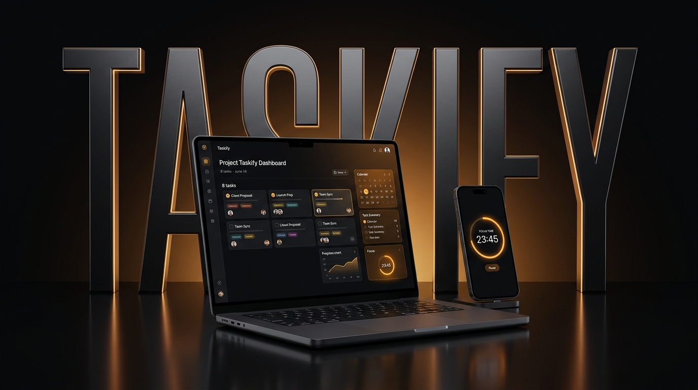

# Taskify

<p align="center">
  
</p>

<p align="center">
  <a href="https://github.com/Vanshdeveloper/Taskify/releases/latest"></a>
  <a href="LICENSE"></a>
  
  
</p>

Taskify is a free and open-source personal productivity app built for speed, simplicity, and complete privacy. It runs entirely on your device with zero cloud servers, no mandatory user accounts, and no telemetry.

---

## Features

- **Tasks**: Create and prioritize tasks with subtasks, due dates, categories, and fast keyboard navigation (`J`/`K`/`Space`/`E`/`D`).
- **Habits & Streaks**: Track daily routines, build consistency momentum, and view 7-day matrix history.
- **Focus Timer**: Work in Pomodoro sessions with 15m, 25m, and 50m presets, ticking audio, and edge perimeter lighting.
- **Notepad**: Distraction-free writing with full undo/redo history, checklist formatting, and instant autosave.
- **SmoothUI Android Widgets**: Native home-screen widgets for Focus Timer, Today Tasks, Daily Routines, 7-Day Consistency Matrix, and Quick Actions.
- **100% Local Storage**: All records persist locally in IndexedDB. Export and import full JSON backups at any time.

---

## Downloads

Official builds are available for desktop and mobile:

| Platform | Format | Release |
|:---|:---|:---|
| Windows | `.exe` (Installer) | [Download for Windows](https://github.com/Vanshdeveloper/Taskify/releases/latest) |
| macOS | `.dmg` | [Download for macOS](https://github.com/Vanshdeveloper/Taskify/releases/latest) |
| Linux | `.AppImage` | [Download for Linux](https://github.com/Vanshdeveloper/Taskify/releases/latest) |
| Android | `.apk` (Direct package) | [Download APK](https://github.com/Vanshdeveloper/Taskify/releases/latest) |

---

## Development Setup

Requirements:
- Node.js 20 or newer
- npm 10 or newer

```bash
# Clone the repository
git clone https://github.com/Vanshdeveloper/Taskify.git

# Install dependencies
cd Taskify
npm install

# Start local development server
npm run dev

# Run unit and contract tests
npm test

# Build for production
npm run build
```

### Mobile Sync (Capacitor)

```bash
# Synchronize web assets to native Android and iOS folders
npm run cap:sync

# Open Android Studio project
npm run cap:android

# Open iOS Xcode project
npm run cap:ios
```

---

## Why I built this

I vibe-coded Taskify for people who want to track everything in one private place: daily tasks, habits, focus blocks, and quick notes. Most tools force you into monthly subscriptions, mandatory accounts, and scattered apps. Taskify keeps all your data strictly on your device with zero tracking.

Try out the app on your desktop or phone. If you spot a bug or have ideas for the layout, navigation, or features, open an issue on GitHub. If you want to fix something or refine the code, submit a pull request. I review every submission and merge verified improvements directly into main.

---

## License

This project is licensed under the MIT License. See [LICENSE](LICENSE) for details.
